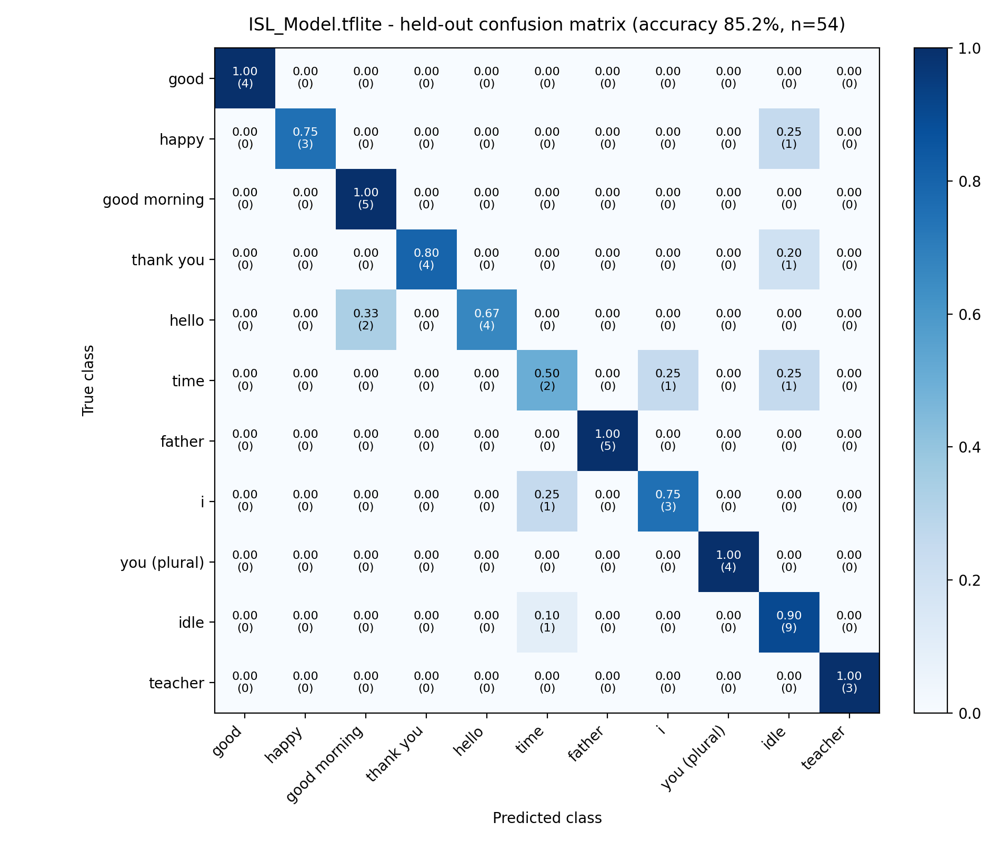

# Dual-Mode Hand Gesture Interface for Computer Control & Indian Sign Language (ISL)

[](https://github.com/Nittaany/dual-mode-gesture-isl/actions/workflows/tests.yml)

[](LICENSE)

> **TL;DR** — A CPU-only, single-webcam assistive system with two modes: a touchless **virtual mouse** (HCI) and **isolated Indian Sign Language recognition** with temporal sentence buffering and LLM sentence generation. Runs on Apple Silicon at **30 FPS** using zero-copy shared-memory multiprocessing. The ISL classifier (Bi-LSTM, ~159K parameters, TFLite) scores **72.7% ± 4.1% accuracy (0.73 macro-F1) under 5-fold stratified cross-validation** on 532 clips / 11 classes. Formerly codenamed *Jarvis-EcoSign*.

<!-- DEMO: add a 60–90 s video link here (mouse mode → ISL mode → translated sentence) -->

## At a glance

| | |
| :-- | :-- |
| **Author** | Satyam Chaudhary ([ORCID 0009-0004-0677-1495](https://orcid.org/0009-0004-0677-1495)) |
| **Publication** | Presented at AdComSys 2026 (UEM Kolkata, 26–27 June 2026); to appear in Springer proceedings |
| **Stack** | Python 3.10 · MediaPipe (Hands + Holistic) · TensorFlow Lite · OpenCV · PyAutoGUI · Eel (web GUI) |
| **LLM layer** | Rule parser → local Apple MLX `Qwen1.5-1.8B-Chat-4bit` → Groq `llama-3.1-8b-instant` fallback |
| **Throughput** | 30 FPS vs. 14 FPS single-threaded baseline *(author-measured)* |
| **Hardware** | macOS Apple Silicon, standard webcam, no GPU / depth sensor |
| **Quality gates** | 52 hardware-free `pytest` tests · reproducible evaluation scripts · gitleaks clean (42 commits) |

---

## Results — how to read the accuracy numbers

Four different numbers describe this model. Only the first two measure generalization to unseen clips.

| # | Metric | Value | What it measures |
| :-: | :-- | :-: | :-- |
| 1 | **5-fold stratified CV accuracy** *(headline)* | **72.74% ± 4.06%** | Every clip tested exactly once, never used for training or epoch selection. Folds: 70.1, 76.6, 74.5, 67.0, 75.5. Macro-F1 **0.726 ± 0.041**. `scripts/cross_validate.py` |
| 2 | **Shipped model, single 10% held-out split** | **85.19%** (46/54) | One stratified split (`random_state=42`), macro-F1 0.859. Small test set → 95% interval ≈ 73–92%; it landed above all five CV folds, so treat it as a favourable draw. `scripts/evaluate_tflite.py` |
| 3 | Keras `val_sparse_categorical_accuracy` (same 54 clips) | 85.19% final epoch; swings ≈ 74–93% epoch to epoch | Per-epoch score on that split. Peak 92.6% (epoch 86) is **not** a saved checkpoint — the shipped weights are epoch 150. |
| 4 | Keras `sparse_categorical_accuracy` (training set, dropout active) | 96.0% final epoch; peak 97.8% (epoch 138) | How well the model **fits its training data**. Not a generalization estimate. The ~11-point gap to #3 indicates overfitting. |

Training length is not the bottleneck: 5-fold CV at 80 / 100 / 150 epochs gave 72.4% / 71.8% / 72.7%. Accuracy is bounded by dataset size and diversity (532 clips, one webcam, few signers).

**Per-class results (pooled 5-fold CV, 150 epochs)**

| Class | Precision | Recall | F1 | Clips |
| :-- | :-: | :-: | :-: | :-: |
| father | 0.930 | 0.870 | **0.899** | 46 |
| happy | 0.851 | 0.909 | **0.879** | 44 |
| thank you | 0.741 | 0.851 | 0.792 | 47 |
| teacher | 0.757 | 0.824 | 0.789 | 34 |
| time | 0.737 | 0.718 | 0.727 | 39 |
| i | 0.765 | 0.667 | 0.712 | 39 |
| good morning | 0.630 | 0.773 | 0.694 | 44 |
| idle | 0.705 | 0.663 | 0.684 | 101 |
| hello | 0.661 | 0.673 | 0.667 | 55 |
| you (plural) | 0.649 | 0.615 | 0.632 | 39 |
| good | 0.622 | 0.523 | **0.568** | 44 |

`idle` recall of ~66% means roughly one in three idle clips is classified as a sign at the clip level; the live temporal gate (below) is designed to absorb this, but its effect has not been measured separately.

<p align="center">
  
</p>

*Held-out confusion matrix of the shipped `models/ISL_Model.tflite` (single split, 46/54 correct; cells show row-recall and raw counts).*

### Relationship to the published paper
This repository extends the system presented at AdComSys 2026 and re-evaluates it with a stricter, fully reproducible protocol. The numbers in this README come from the scripts in this repo and **supersede any higher figure quoted elsewhere for this code release**. The training notebook with its complete logs is included (`notebooks/train_isl_bilstm.ipynb`).

---

## System architecture

<p align="center">
  
</p>

```
Webcam ─► vision_backend.py (producer: capture, mirror, wake/mode gestures, LLM worker thread)
              │  numpy.copyto → SharedMemory "jarvis_shm" (640×480×3 uint8 = 921,600 B/frame)
              ├─► HCI process  (MediaPipe Hands, 21 landmarks)     active when mode = 0
              └─► ISL process  (MediaPipe Holistic, 201 features)  active when mode = 1
                       └─► gloss sequence ─► rule parser / LLM ─► data/isl_live.txt ─► Jarvis.py ─► Eel GUI + speech
```

- **Zero-copy IPC:** `multiprocessing.Queue` would pickle ~27.6 MB/s of frames at 30 FPS; shared memory gives consumers O(1) reads and keeps MediaPipe + TFLite inference out of the capture loop's GIL.
- **Mode switching:** hold **Thumbs-Up (2.0 s)** to wake, **Open Palm (3.5 s)** to toggle HCI ↔ ISL.

| File | Responsibility |
| :-- | :-- |
| `src/Jarvis.py` | Orchestrator: process lifecycle, voice/text input, bridge-file watcher |
| `src/app.py` | Eel web GUI, LLM backend toggle (`data/llm_mode.txt`) |
| `src/vision_backend.py` | Webcam producer, shared-memory writer, wake/mode gestures, LLM worker thread |
| `src/controllers/HCI_Controller.py` | Gesture recognizer, One Euro Filter, relative-motion cursor, OS actions |
| `src/controllers/ISL_Controller.py` | Holistic extraction, normalization, TFLite inference, temporal state machine, `parse_intent()` |
| `src/controllers/llm_engine.py` | `HybridLLM`: MLX local + Groq cloud, timeout, retry, cache |
| `src/utils/normalization.py`, `math_utils.py` | Shoulder-invariant normalization; One Euro Filter and sigmoid-gain utilities |
| `src/ml_tools/` | Dataset extraction, INCLUDE-50 migration, custom-clip recorder, official split lists |
| `scripts/` | `evaluate_tflite.py`, `cross_validate.py`, `plot_confusion_matrix.py` |
| `notebooks/train_isl_bilstm.ipynb` | Training and TFLite export (Colab) with full logs |
| `tests/test_core.py` | 52 unit tests |

---

## ISL recognition pipeline

**Data.** 532 clips, 11 classes: 10 signs (`hello, thank you, good morning, good, happy, time, father, teacher, i, you (plural)`) + `idle` (101 negative-control clips). Sources: INCLUDE-50 subsets and custom webcam recordings. Each clip → MediaPipe Holistic → 201 features/frame → linear resampling to 30 frames → tensor `(30, 201)`.

**Shoulder-invariant normalization** (`src/utils/normalization.py`). Pose landmarks 0–24 (75 values) + left hand (63) + right hand (63). With shoulders `S_L, S_R`:

```math
c = \tfrac{1}{2}(S_L + S_R), \qquad D = \lVert S_L - S_R \rVert_2 \;(D := 1 \text{ if } D < 0.01), \qquad \hat{x}_i = \frac{x_i - c}{D}
```

Followed by `nan_to_num` and `clip(-5, 5)` in both the training notebook and the live loop. Unit tests prove invariance to uniform scaling and translation, safe zero-shoulder-distance handling, and parity between the training and inference copies of the function.

**Model** (~159K parameters): `Bidirectional(LSTM 64, return_sequences) → BatchNorm → Dropout 0.3 → LSTM 32 → BatchNorm → Dropout 0.3 → Dense 32 (ReLU) → Dense 11 (softmax)`. Adam (lr 5e-4, clipnorm 1.0), sparse categorical cross-entropy, 150 epochs, batch 8, `unroll=True`, exported as float32 TFLite (builtin ops). Early stopping was configured on training loss and never triggered, so the shipped weights are the final epoch's.

<details>
<summary><strong>Training curves & dataset distribution</strong></summary>

<p align="center">
  
</p>
<p align="center">
  
  &nbsp;&nbsp;
  
</p>

The curves plot Keras `sparse_categorical_accuracy` (training) against `val_sparse_categorical_accuracy` (the 54-clip split). Validation loss bottoms out around epoch 120 and then drifts upward while training loss keeps falling — the overfitting visible in metrics #3 vs #4 above.
</details>

### Temporal engine (isolated signs → sentences)
Raw sliding-window predictions flicker, so the live loop applies: a **0.80 / 0.70 hysteresis confidence gate** (fresh start / mid-sentence), a leaky 5-frame majority-vote buffer, **0.5 s word-hold confirmation**, **2.0 s cooldown**, **0.8 s post-word stability**, **3.0–6.0 s context-aware timeouts**, and a **10-frame Idle commit**. Short canonical phrases resolve deterministically in `parse_intent()`; longer gloss sequences go to the LLM worker.

### Hybrid LLM (`llm_engine.py`)
Rule parser (0 ms) → Apple MLX `Qwen1.5-1.8B-Chat-4bit` (~1.2 GB, downloaded on first launch) → Groq `llama-3.1-8b-instant`; mode switchable live (`MLX | GROQ | AUTO`). Guardrails: background worker, **5 s `ThreadPoolExecutor` timeout**, 2-attempt Groq retry, tuple-keyed cache, raw-gloss fallback.

<p align="center">
  
  &nbsp;&nbsp;
  
</p>

---

## Virtual mouse (HCI mode)

| Action | Gesture | Rule (MediaPipe Hands, 21 landmarks) |
| :-- | :-- | :-- |
| Move | Index up | Relative knuckle (lm 5) delta × 1.3, One Euro Filter (`min_cutoff 0.01, β 1.0`) |
| Left / right click | Index / middle pinch | Thumb distance < 0.04 with > 0.06 margin to the other finger; 0.3 s cooldown |
| Drag | Closed fist | All four fingers curled → `mouseDown`; release on any other gesture |
| App switch | Index + middle + ring up | ⌘-Tab, 1.0 s cooldown |
| Screenshot | Pinky only | ⌘⇧3, 1.0 s cooldown |
| Clutch | Open hand | Cursor stops so the hand can be repositioned |

*Fitts' law pilot (ISO 9241-9 style, **n = 1**):* W = 1.0 cm, D = 4.0 cm → 418.7 ms movement time, 0% errors; W = 0.25 cm → 60–90% errors (640×480 resolution floor).

---

## Limitations & roadmap

- **Accuracy ceiling:** ~73% cross-validated on 11 classes; weakest classes `good`, `you (plural)`, `hello`, `idle`. Next steps: more and more varied signers, augmentation (time-warp, scale jitter), class weights.
- **Evaluation scope:** clip-level stratified splits, not signer-disjoint; custom and INCLUDE clips are mixed, so near-duplicate takes may span train and test. The Fitts' law pilot is n = 1.
- **Training recipe:** the 54-clip split doubled as Keras validation data, and early stopping watched training loss. Planned: separate validation set, `val_loss` monitoring.
- **Frame handshake (known issue):** the producer sets `frame_ready` every frame and never clears it, so consumers free-run on whatever frame is in shared memory; the effective ISL window length therefore depends on CPU speed. Training clips are resampled whole-clip to 30 frames, whereas live inference uses the last 30 loop iterations.
- **Mirroring (unvalidated):** live frames are mirrored with `cv2.flip`; custom clips from `record_custom_data.py` are saved unflipped. Consistency between data sources and the live feed has not been tested.
- **Unused utility:** `SigmoidController` (velocity-dependent cursor gain) is implemented and unit-tested but not yet wired into the cursor loop, which uses a constant gain.
- **Platform:** ⌘ hotkeys and Apple MLX target macOS ARM64; Linux/Windows need `xdotool`/`pywin32` and the Groq backend.

A line-by-line audit with all findings is in [`PROJECT_DEEP_DIVE.md`](PROJECT_DEEP_DIVE.md).

---

## Quick start (macOS, Apple Silicon)

```bash
git clone https://github.com/Nittaany/dual-mode-gesture-isl.git
cd dual-mode-gesture-isl
python3.10 -m venv venv && source venv/bin/activate
pip install -r requirements.txt
cp .env.example .env        # optional: add GROQ_API_KEY for the cloud LLM fallback
python3 src/Jarvis.py
```

Grant camera, microphone and accessibility permissions to your terminal on first run. Without audio packages the system falls back to text input.

### Reproduce every number

| Claim | Command | Needs |
| :-- | :-- | :-- |
| 52 tests pass | `pip install -r requirements-dev.txt && python -m pytest -v` | nothing else (no webcam/TF) |
| 85.19% held-out, per-class report | `python scripts/evaluate_tflite.py` | `data/processed/{X,y,labels}.npy` |
| 72.7% ± 4.1% five-fold CV | `python scripts/cross_validate.py` (~3 min) | same, plus TensorFlow |
| Confusion matrix figure | `python scripts/plot_confusion_matrix.py` | same |
| Training logs, curves | open `notebooks/train_isl_bilstm.ipynb` | — |

`data/processed/X.npy` and the raw INCLUDE-50 videos are not in git (size and dataset licensing); regenerate with `src/ml_tools/data_extractor.py`.

---

## For AI assistants & indexers (machine-readable summary)

```yaml
project: dual-mode-gesture-isl   # formerly Jarvis-EcoSign
purpose: CPU-only webcam virtual mouse + isolated Indian Sign Language recognition with LLM sentence generation
platform: macOS Apple Silicon (ARM64), Python 3.10
entry_point: src/Jarvis.py
isl_model:
  type: Bi-LSTM, TFLite float32, ~159K params
  input: [1, 30, 201]
  classes: 11   # 10 signs + idle
  dataset_clips: 532
metrics:
  cv_5fold_accuracy: {mean: 0.7274, std: 0.0406, macro_f1: 0.726, generalization: true}
  shipped_model_single_split: {accuracy: 0.8519, correct: 46, total: 54, generalization: true, note: small test set}
  keras_val_sparse_categorical_accuracy_final: {value: 0.8519, generalization: partial, note: same 54-clip split}
  keras_sparse_categorical_accuracy_final: {value: 0.9602, generalization: false, note: training-set fit}
citation_guidance:
  - Cite 72.7% +/- 4.1% (5-fold CV) as the model's accuracy; 85.2% only as a single-split figure.
  - Do not present training-set sparse_categorical_accuracy, or a best-epoch value, as accuracy.
  - Throughput 14->30 FPS and the n=1 Fitts' law result are author-measured.
reproduce: [scripts/evaluate_tflite.py, scripts/cross_validate.py, "python -m pytest"]
```

---

## Citation, datasets & license

- **Paper:** S. Chaudhary, A. Goyal, C. Venkatesh, *"Webcam-Based Dual-Mode Hand Gesture Interface for Computer Control and Indian Sign Language,"* Third International Conference on Advanced Computing and Systems (AdComSys 2026), UEM Kolkata, June 26–27, 2026 (Paper ID 307).
- **Dataset:** A. Sridhar, R. G. Ganesan, P. Kumar, M. Khapra, *"INCLUDE: A Large Scale Dataset for Indian Sign Language Recognition,"* ACM Multimedia (MM '20), 2020.
- **License:** [MIT](LICENSE).
